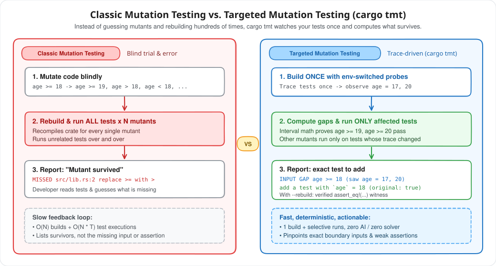
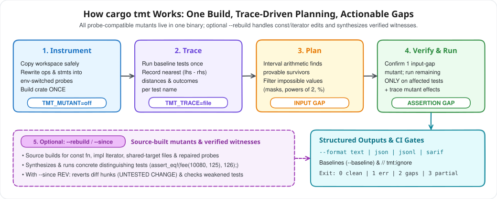

# targeted-mutation

[](https://crates.io/crates/targeted-mutation)
[](https://github.com/t-k/targeted-mutation/actions/workflows/ci.yml)
[](LICENSE)
[](#quick-start)

**Targeted mutation testing for Rust (`cargo tmt`)**: finds the realistic wrong implementations your tests would let through — and tells you the **exact input or assertion** that catches them.

> Other languages: [JavaScript and TypeScript](https://github.com/t-k/targeted-mutation-ts) · [Go](https://github.com/t-k/targeted-mutation-go) · [Swift](https://github.com/t-k/targeted-mutation-swift) · [Python](https://github.com/t-k/targeted-mutation-python)

## Why targeted mutation testing?

Classic mutation testing mutates code blindly (`<` → `<=`), recompiles the crate for every mutant, runs the whole test suite each time, and leaves you with *"mutant survived"* to diagnose by hand.

**`cargo tmt` flips the workflow:**

1. It compiles your crate **once** with runtime-switched probes and traces what values your tests actually feed each site.
2. From those observations, it uses **interval arithmetic** to compute the boundary mutants guaranteed to pass every test (for deterministic tests; re-verified by default) — without needing AI or an SMT solver.
3. For mutants that *do* change an observation, it runs **only the tests affected by that site**, traces what changed downstream, and points straight to the missing input or weak assertion.



| | Classic mutation testing | Targeted mutation testing (`cargo tmt`) |
|---|---|---|
| **Builds** | Rebuilds once per mutant (`O(N)`) | **1 build** for all probe-compatible mutants |
| **Test runs** | Runs the whole suite per mutant | Skips provable survivors; runs **only affected tests** |
| **Output** | `MISSED src/lib.rs:2 replace >= with >` | *"Saw `age` = 17, 20 → add a test with `age` = 18"* |
| **Weak assertions** | Manual debugging | Effect trace (`with the mutant, ...`) + verified `assert_eq!` (`--rebuild`) |
| **Dependencies** | — | Pure Rust, **no AI, no SMT solver** |

---

## Quick start

Building `cargo tmt` requires Rust **1.88 or newer**. The crates it analyses are built with whatever toolchain is active for them.

```sh
cargo install targeted-mutation
cargo new --lib demo && cd demo
```

Put this in `src/lib.rs`:

```rust
pub fn is_eligible(age: u32) -> bool {
    age >= 18
}

#[test]
fn minor_is_rejected() {
    assert!(!is_eligible(17));
}

#[test]
fn adult_is_accepted() {
    assert!(is_eligible(20));
}
```

Run `cargo tmt`:

```text
$ cargo tmt --quiet
INPUT GAP  src/lib.rs:2:5
    age >= 18
  passes every test as: `age >= 19`, `age >= 20`  [re-run: tests pass]
  nearest values the tests passed: `age` = 17, 20
  add a test with `age` = 18 (the original gives true)

demo: 4 sites, 1 input gaps, 0 assertion gaps, 8 mutants run (6 killed), 0 sites unreached
$ echo $?
2
```

Add the exact test it asks for and re-run:

```rust
#[test]
fn eighteen_is_accepted() {
    assert!(is_eligible(18));
}
```

```text
$ cargo tmt --quiet
demo: 4 sites, 0 input gaps, 0 assertion gaps, 7 mutants run (7 killed), 0 sites unreached
$ echo $?
0
```

### Deeper bugs & verified witnesses (`--rebuild`)

Some wrong implementations can only be caught by building source mutants one by one — and with `--rebuild`, `cargo tmt` also synthesizes and verifies concrete distinguishing tests. Append a basis-points fee function and its tests to the same `src/lib.rs`:

```rust
pub fn fee(cents: u32, bps: u32) -> u64 {
    u64::from(cents) * u64::from(bps) / 10_000
}

#[test]
fn round_amounts() {
    assert_eq!(fee(10_000, 125), 125);
    assert_eq!(fee(20_000, 250), 500);
}
```

Plain `cargo tmt` finds nothing; `cargo tmt --rebuild` tries dividing before multiplying, runs a generated test against both versions, and gives the exact assertion to add:

```text
SURVIVOR  src/lib.rs:21:5
    u64::from(cents) * u64::from(bps) / 10_000
  passes every test as: `u64::from(cents) / 10_000 * u64::from(bps)` (divide before multiplying)
  verified on `fee(10080, 125)`: original returned 126, mutant returned 125
  The tests pass with the division by 10000 done first; this `cents` is not a multiple of it.
  add a test with `assert_eq!(fee(10080, 125), 126);`
```

> **Security note:** `cargo tmt` builds and runs the target crate's tests and build scripts, just as `cargo test` does. Run it only on code you trust.

---

## Understanding findings

| Finding | Meaning | What to add |
|---|---|---|
| **`INPUT GAP`** | No test passes a value separating the mutant from the original. | A test with the listed boundary input. |
| **`ASSERTION GAP`** | Tests execute the changed behaviour and still pass. | An assertion in one of the listed tests (guided by `with the mutant, ...`). |
| **`SURVIVOR`** | A source-built mutant (`--rebuild` / `--source-only`) passes all tests. | A test using the verified witness (if shown) or covering the mutated code. |
| **`UNTESTED CHANGE`** | With `--since REV` + rebuild mode, reverting a diff hunk still passes all tests. | A test that fails on the old code (or silence refactorings with `// tmt:ignore`). |
| **`UNREACHED`** | No test executes the site (shown with `--show-unreached`). | A test reaching the branch/code. |
| **`UNSTABLE`** | A trace-predicted survivor failed on re-run. | Fix test nondeterminism first. |

Findings on the same source line are grouped into one block.

### Input gaps & impossible-value filtering

In `fixtures/eligibility`, the tests only pass `17` and `20` to `age >= 18`, so any threshold in `18..=20` behaves identically on every test. `cargo tmt` derives that range directly from the two nearest observations and names `age = 18`.

Values no input can produce are filtered out automatically: `blocks * 8` is always a multiple of 8, `flags & 0xF0` only has bits of the mask, and `n % 10` is strictly below 10. When no reachable value lies between the observed values — or when an expression cannot flip a comparison (`n % 10 < 10`, `flags & 0b1100 == 1`) — no bogus gap is reported. Reachability is derived from the expression's outer integer operation where tests executed it on primitive integers and the invariant holds under wrapping (power-of-two products, bit shifts modulo type width, bit masks, and remainders).

### Assertion gaps & effect tracing

`fixtures/batch-store` has an atomic batch commit whose test checks that a failing batch returns an error, but never inspects store state afterwards:

```text
$ cargo tmt fixtures/batch-store
ASSERTION GAP  src/lib.rs:33:9
    self.check_preconditions(batch)?;
  passes every test as: delete `self.check_preconditions(batch)?;`
  these tests run the changed code and still pass: tests::batch_writes_are_visible_after_commit, tests::commit_fails_when_an_update_target_is_missing
  with the mutant, `tests::commit_fails_when_an_update_target_is_missing` now runs `self.docs.insert(key.clone(), value.clone());` (src/lib.rs:59)
  add an assertion on what this code is responsible for
```

For each assertion gap, `cargo tmt` replays one surviving mutant with tracing on (`effects_of` in JSON) and compares its trace with the original run. When the mutant changes nothing observable in the trace, either the test ignores the mutated value, its assertion holds for both outcomes (`assert_ne!(bucket(3), "none")`), or the mutant is equivalent.

---

## How it works



1. **Instrument.** Rewrites comparisons, boolean operators, arithmetic/bitwise operators, ranges, `min`/`max`, `first`/`last`, match arms/guards, struct fields, return exits, and deletable statements into runtime-switched probes inside an isolated working copy. The crate is compiled **once**.
2. **Trace.** Runs the tests once and records per-test observations (for integer comparisons: nearest `lhs - rhs` on each side of zero and whether operands were ever equal).
3. **Plan.** Computes provable input-gap survivor ranges by interval arithmetic, excluding impossible values within the operand types (`x >= 0` for unsigned `x`, masks, remainders, etc.). By default one predicted survivor per gap is re-run to confirm (`--no-verify` skips this).
4. **Verify & Run.** Runs remaining mutants only against the tests whose observations change, stopping at the first failure. Survivors are traced to show downstream effects (`--no-effects` skips this).
5. **Source builds & witnesses (optional `--rebuild` / `--source-only`).** Code that cannot carry runtime probes (`const fn`, `const`/`static` initializers, `impl Iterator`, untyped literal pairs like `60 * 60`, complex compound assignment places like `*map.entry(k).or_insert(0) += 1`, secondary/shared targets, or probes dropped by repair) is compiled and tested per mutant. Without `--rebuild`, the summary tells you how many candidates need it.

### What is mutated

| Code | Mutants | Provable survivor when |
|---|---|---|
| `a < b`, `a >= 18` (integers) | shifted thresholds, negated operator | no test passes a value between old and new boundary |
| `x > 30.5` (floats) | `>=`, thresholds between nearest observed values | operands were never equal in any test |
| comparisons on other `PartialOrd` types | `<` ↔ `<=`, negation | operands were never equal in any test |
| `a == b`, `a != b` | negation, `true` / `false` | result was identical in every test |
| `a && b`, `a \|\| b` | ignored operand (`a && { b; true }`, `{ a; b }`), swapped operator | ignored operand never decided the result |
| `+`, `-`, `*`, `/`, `%` & compound assigns | two alternatives each (`+`→`-`,`*`; `-`→`+`,`/`; `*`→`/`,`+`; `/`→`*`,`%`; `%`→`/`,`+`) | both operators are defined and agree on every observed pair |
| `&`, `\|`, `^`, `<<`, `>>` & compound assigns | bitwise alternatives / `<<` ↔ `>>` | as above |
| `!x` (`bool`), `-x` / `-1` | `x`, `1` | always run |
| function bodies | return-type value replacements (`()`, `0`/`1`/`-1`, `bool`, `String`, `Option`, `Result`, `Vec`/collections, `Box`, tuples/arrays, `Default::default()`, plus `--error EXPR`) | always run |
| `match` arm guards | `true`, `false` | guard had the same value in every test |
| `match` arms before a catch-all | arm removed (falls through) | always run |
| struct literal field with `..base` | field omitted (falls back to `base`) | always run |
| `-> bool` / `-> Option<T>` normal exits | `true` / `false` (`bool`), `None` (`Option`) | function always returned that value |
| `a.max(b)`, `a.min(b)` (numbers) | swapped `min` ↔ `max` | operands were equal in every test |
| `v.first()`, `v.last()` (slice/`Vec`/array/`BTreeSet`) | swapped `first` ↔ `last` | no test passed more than one element |
| `s.starts_with(p)`, `s.ends_with(p)` (`str`/`String`) | relaxed to `s.contains(p)` | no test passed a string containing `p` away from that end |
| `s.replace(a, b)`, `s.replacen(a, b, 1)` (`str`/`String`) | swapped `replace` ↔ `replacen(..., 1)` | no test had `a` occur more than once |
| `x.clamp(lo, hi)` (numbers) | `x.min(hi)` (drop lower), `x.max(lo)` (drop upper) | no test crossed that bound (impure/panicking bounds use `--rebuild`) |
| `x.floor()`, `.ceil()`, `.round()`, `.trunc()` (floats) | two alternative rounding modes each | observed inputs gave the same rounded value under the alternative |
| `iter.all(f)`, `iter.any(f)` (`Iterator` with closure) | swapped `all` ↔ `any` | always run |
| `iter.position(f)`, `iter.rposition(f)` (`DoubleEndedIterator + ExactSizeIterator` with closure) | swapped `position` ↔ `rposition` | always run (reaching tests only) |
| `a.saturating_{add,sub,mul}(b)` ↔ `a.wrapping_{add,sub,mul}(b)` (integers) | swapped `saturating_*` ↔ `wrapping_*` | no test hit overflow or underflow |
| `s.trim()`, `.trim_start()`, `.trim_end()` (`str`/`String`) | `trim` → `trim_start`/`trim_end`; `trim_start`/`trim_end` → `trim` | no test had whitespace on the dropped side |
| `a.eq_ignore_ascii_case(b)` (`str`/`String`/`[u8]`/`u8`) | tightened to `a == b` | no test matched only when ignoring ASCII case |
| `x.abs()` (signed integers, floats) | dropped `.abs()` (`x`) | no test passed a negative value |
| `iter.take(n)`, `iter.skip(n)` (`Iterator` with `usize`) | `take(usize::MAX)`, `skip(0)` | `n` was always `usize::MAX` / `0` (otherwise run) |
| `x.to_be_bytes()`, `.to_le_bytes()`, `.to_be()`, `.to_le()` (multi-byte ints) | swapped BE ↔ LE | every observed value was byte-palindromic |
| `x.leading_zeros()`, `.trailing_zeros()`, `.leading_ones()`, `.trailing_ones()` (integers) | swapped leading ↔ trailing | leading and trailing counts agreed on every test |
| `break`, `continue` (unlabeled, value-less inside loops) | swapped `break` ↔ `continue` | always run (reaching tests only) |
| `[lit1, lit2, ...].contains(&x)` (2–8 distinct literals) | one element removed at a time | no test matched that literal element (non-`&expr` / `const` uses `--rebuild`) |
| `(a..b).contains(x)`, `(a..=b).contains(x)` (primitive ordered types) | inclusive ↔ exclusive end | no test passed `x == b` with `a <= b` |
| `a..b`, `a..=b` (integers / indexed slices) | inclusive ↔ exclusive end | always run (`for` loops, `&xs[a..b]`/`&mut xs[a..b]`/`xs[a..b].read_method()`, and `xs.get(a..b)`/`xs.get_mut(a..b)`; others use `--rebuild`) |
| `f(x);`, `check()?;`, `x += 1;`, `x = y;` | statement deleted | always run |

- Arithmetic on non-primitive types (`String + &str`, `Duration + Duration`) and `!` on non-`bool` types are left untouched.
- Enclosing sites do not repeat inner findings (if `a > 0` is always true, `a > 0 && b` does not emit a duplicate finding).
- Arguments inside `assert_eq!`, `assert_ne!`, `vec!`, `format!`, `print!`, `println!`, `eprint!`, `eprintln!`, `write!`, `writeln!`, `panic!`, `unreachable!`, `todo!`, `unimplemented!`, `format_args!`, and `matches!` are mutated; `assert!`, `debug_assert!`, and `dbg!` are skipped because they stringify their argument expression.
- Functions, `impl` blocks, and modules marked `#[mutants::skip]` (including inside `cfg_attr`) are skipped.
- Probes that fail to compile are dropped automatically and retried; `--rebuild` evaluates their source mutants individually.

### Verified witnesses (`--rebuild`)

When `--rebuild` (or `--source-only`) finds a surviving mutant in a library file, `cargo tmt` can synthesize and run a concrete distinguishing test in the working copy, reporting both observed outputs and an `assert_eq!` line (exposed as `findings[].witness` in JSON):

- **Slice searches & inclusive ranges**: two-match inputs distinguishing `position` vs `rposition`, and minimal edits to literal test slices for inclusive range bounds.
- **Bitmasks & Unicode length**: partial multi-bit masks (any-bit vs all-bit) and non-ASCII characters (`chars().count()` vs `.len()`).
- **Comparisons & sort keys**: swapping same-type integer parameters/fields across a boundary, and two-record inputs separating sort-key choices.
- **Post-failure state reads**: borrowing a read from a nearby test to check persisted state after a failing batch operation.
- **Integer rounding (`a * b / c`)**: trying `a / c * b` with the smallest non-multiple offset from an existing test call (`fixtures/rounding`).
- **Composite keys (`format!` / tuples)**: omitting each argument to detect map keys that never collide in tests (`fixtures/keyed`).
- **Paired endian codecs**: flipping byte order on both encode and decode to detect round-trip-only codec tests and suggest a fixed-bytes check.
- **Stronger assertions on existing test calls**: replaying unpinned calls (`assert_ne!(bucket(3), "none")`, `assert!(total(&[1, 2]) > 0)`, `let` bindings, including `super::f(...)` in `mod tests`) in place inside a copy of the test to suggest exact `assert_eq!` values (`witness.in_test`, `in_test_line`, `in_test_column`). When both original and mutant return the same multi-field `Debug` struct differing on one field (recursively), `cargo tmt` narrows and compiler-verifies the assertion to that field (`assert_eq!(quote(200, 3).fee, 600);`, recorded in `witness.field`) even without `PartialEq`.

<details>
<summary>Details: witness fixture examples and in-place assertion replay rules</summary>

Try the bundled witness fixtures directly:

```sh
cargo tmt fixtures/shapes --rebuild --lines src/lib.rs:4-9 --lines src/lib.rs:28-29
cargo tmt fixtures/shapes --rebuild --lines src/lib.rs:34-40
cargo tmt fixtures/operators --rebuild --lines src/lib.rs:72-74
cargo tmt fixtures/distinguishing --rebuild
cargo tmt fixtures/batch-store --rebuild --lines src/lib.rs:33
cargo tmt fixtures/rounding --rebuild
cargo tmt fixtures/keyed --rebuild
```

In-place assertion replay runs a copy of the test beside the original and records the value at the exact point of the call (preserving setup before and teardown after):
- Calls already pinned by `assert_eq!`/`assert!` (whose other side calls no function of the file), multi-line calls, closure/branch/loop calls, methods, generic/`async`/`unsafe`/`const` functions, and calls with non-literal arguments are skipped.
- Tests that are `#[ignore]`, `#[should_panic]`, return `Result`, or shadow the function name with a `let` binding are skipped.
- At most 4 distinct calls (deduplicated by normalized argument tokens) are tried per function; not active with `--literal-operators`.
- A test that depends on its own thread name or `line!()`, or holds a lock required by `Debug`, can differ in the copied test.

</details>

### PR-scoped analysis (`--since REV`)

Pass `--since "$(git merge-base origin/main HEAD)"` to scope analysis to lines changed in a pull request plus untracked files.

#### Untested changes (`--since` + `--rebuild` / `--source-only`)

Each diff hunk in production code is reverted to `REV`, built, and tested. Multi-addition hunks are also decomposed into independent AST sub-hunks (added `&&`/`||` conditions, added struct literal fields with `..base`, and added standalone statements), so an untested clause inside an otherwise-tested hunk is still caught. If every test still passes, the tests cannot tell the new code from the old:

```text
$ cargo tmt --rebuild --since "$(git merge-base origin/main HEAD)"
UNTESTED CHANGE  src/lib.rs:9:1
    now - used < 30 && created <= used
  passes every test with the code as it was: `let _ = used; now - created < 30`
  no test tells this change from the code as it was at 91e1dc927360: add one that fails without it
```

#### Weakened tests (`--since`)

When a file's inline tests (`#[cfg(test)]` / `#[test]`) changed since `REV`, `cargo tmt` inspects the whole file and re-runs surviving mutants in unchanged lines against the tests as they were at `REV`. Mutants the old tests caught are reported under `weakened` (and as `weakened-test` in SARIF):

```text
INPUT GAP  src/lib.rs:27:5
    age >= 18
  passes every test as: `age >= 19`, `age >= 20`  [re-run: tests pass]
  nearest values the tests passed: `age` = 17, 20
  add a test with `age` = 18 (the original gives true)
  the tests as they were at e76c0bd70fff found this out: a change to the tests lets it through
```

<details>
<summary>Details: diff-revert and weakened-test edge cases</summary>

- Comment-only, whitespace-only, test-only, and trailing-comma-only hunks (in braces, brackets, and plain calls) are ignored. `#[doc = ".."]` passed to a macro counts as a token; doc comments do not.
- Test code is kept intact when reverting production hunks (mixed hunks with unequal old/new line counts are reported as not evaluated).
- Changes inside `cfg`-disabled code are skipped when the built tokens are identical (accounting for `line!`, `column!`, `#[track_caller]`, `RUSTFLAGS`, and build scripts).
- Hunks that fail to compile alone are retried together per file (and across files if needed).
- Changes are tried even where no probe site exists (e.g. constants), but are not tried with `--shard` or `--list`. In JSON they appear as `kind: "survivor"` with `change_since`.
- Weakened-test detection needs no `--rebuild` (costs two extra builds only when tests changed), skips pre-existing gaps, falls back to changed lines if old tests do not compile/pass on new code, and does not trace standalone `tests/*.rs` files back to library files.

</details>

---

## CLI & workflows

Run `cargo tmt -h` for a compact overview or `cargo tmt --help` for full descriptions, examples, and exit codes.

### Common recipes

```sh
# Current package (fast probe mode)
cargo tmt

# Pull request diff with source builds and verified witnesses
cargo tmt --rebuild --since "$(git merge-base origin/main HEAD)"

# Workspace streaming (preserves completed packages if one fails)
cargo tmt --workspace --format jsonl

# GitHub Code Scanning / SARIF 2.1.0
cargo tmt --format sarif > tmt.sarif

# CI sharding in source-only mode
cargo tmt --workspace --source-only --shard 0/4 --format json

# Migrating a cargo-mutants + nextest CI job
cargo tmt --source-only --literal-operators --test-tool nextest --nextest-profile ci

# Preview source edits without building or running tests
cargo tmt --list --format json
```

### Exit codes

| Code | Meaning |
|---|---|
| **`0`** | No gaps found (also `--help` and `--version`) |
| **`1`** | Analysis or CLI error (invalid arguments, baseline tests failed, build error) |
| **`2`** | Test gaps, unstable predictions, or `--audit` discrepancies found |
| **`3`** | Incomplete evaluation (unconfirmed parallel timeouts, no mutants executed, or `--source-only` timeout/unevaluated) |

### Report counts & evaluation status

Every JSON report satisfies three exact accounting identities:

- `mutants_run == mutants_killed + mutants_survived`
- `mutants_timed_out <= mutants_killed` (`mutants_timed_out` is a subset of `mutants_killed`, not an additional bucket)
- `mutants_survived == survivor_breakdown.reported + survivor_breakdown.suppressed + survivor_breakdown.redundant_constant + survivor_breakdown.preexisting_unchanged + survivor_breakdown.unchanged_not_compared + survivor_breakdown.unconfirmed_gap`

| Field | Meaning |
|---|---|
| `mutants_run` | Evaluated mutants whose run completed (`Fail`, confirmed `Timeout`, or `Pass`). Excludes unbuilt, unviable, unable, and unconfirmed-timeout mutants. |
| `mutants_killed` | Subset of `mutants_run` caught by a test failure or confirmed timeout. |
| `mutants_timed_out` | Subset of `mutants_killed` stopped by the timeout limit. |
| `mutants_survived` | Subset of `mutants_run` that passed all selected tests (`mutants_run - mutants_killed`). |
| `survivor_breakdown.reported` | Surviving mutants emitted in `findings` (note that one finding can group multiple mutants at the same site, and unverified `--no-verify` input gaps contribute `0` here because no mutant was run). |
| `survivor_breakdown.suppressed` | Surviving mutants whose finding was suppressed by `// tmt:ignore` or `--baseline`. |
| `survivor_breakdown.redundant_constant` | Surviving mutants omitted because an enclosing or sole expression was already classified as constant in the tests. |
| `survivor_breakdown.preexisting_unchanged` | Surviving mutants in unchanged code (reached by changed tests under `--since`) confirmed to have also survived the earlier tests. |
| `survivor_breakdown.unchanged_not_compared` | Surviving mutants in unchanged code (under `--since`) that could not be compared against the earlier tests (e.g. earlier tests failed to build/pass or the rerun was unable/unconfirmed). |
| `survivor_breakdown.unconfirmed_gap` | Surviving confirmation mutants whose predicted gap was not confirmed (another confirmation mutant for the same gap was refuted or unevaluated). |
| `mutants_not_built` | Source-only mutants skipped because `--rebuild` was not passed. |
| `mutants_not_evaluated` | Mutants that could not be evaluated (including `mutants_not_compiled`, unrepresentable probe ranges, unable runs, or unconfirmed timeouts). |
| `unviable_mutants` | Candidate mutants rejected by the compiler (never counted in `mutants_run`). |
| `evaluation` | Omitted (`null`) when every discovered mutant was evaluated (note: `--no-verify` still omits `evaluation` when all scheduled mutants ran; check `analysis.verified` if verification is required); `"partial"` when `mutants_run > 0` and any of `mutants_not_built`, `mutants_not_evaluated`, `skipped_sites`, `unparseable_source` in `skipped`, `survivor_breakdown.unchanged_not_compared`, `timeout_rechecks.unconfirmed`, or `--source-only` `mutants_timed_out` is non-zero; `"no_sites"` when there is nothing to mutate; `"no_mutants_executed"` when no mutant ran despite sites, skipped files/sites, unbuilt mutants, or unevaluated mutants (exits `3`). |

> **CI tip:** Running without `--rebuild` exits `0` when all evaluated probe mutants are killed, even if `mutants_not_built > 0`. Check `evaluation == null` (or pass `--rebuild`) when you want a CI gate to require that no mutants were left unbuilt.

### Configuration file (`tmt.toml`)

Project- and workspace-wide defaults can be stored in TOML instead of repeating CLI flags. `cargo tmt` walks upward from the target directory to the workspace root (`[workspace]` in `Cargo.toml`) or `.git` boundary and auto-discovers one of:

- `tmt.toml`
- `.config/tmt.toml`
- `.cargo/tmt.toml`

If more than one candidate exists in the same directory, `cargo tmt` exits with an error so the active file is never ambiguous. Pass `--config <FILE>` to load an explicit file or `--no-config` to disable auto-discovery.

```toml
# Workspace-wide defaults
opt_level = 1
jobs = 4
locked = true
exclude_test = ["tests::slow_e2e"]

# Per-package overrides (applied in both single-package and --workspace runs)
[package.my-crate]
lib = true
copy_fixture = ["fixtures/data"]
```

- **Precedence:** built-in defaults `<` top-level config `<` `[package.<name>]` `<` CLI flags. Upper layers replace scalar and array values (use `[]` to clear an inherited list), and explicit mode switches (such as `--source-only` overriding `rebuild = true`, or `--features` overriding `all_features = true`) clear the conflicting lower-layer flag automatically.
- **Relative paths:** `baseline` and `work_dir` resolve relative to the project directory holding the discovered config (or the explicit `--config` file's parent). In `--workspace` runs, a top-level `work_dir` serves as the shared parent directory (`<work_dir>/<member>`) while a per-package `[package.<name>].work_dir` overrides that member's work directory individually (overlapping directories are rejected). Workspace-relative options (`test_wrapper`, `copy_fixture`, `copy_fixture_exclude`) remain relative to the workspace root; `copy_output_fixture` maps workspace-relative `FROM` to isolated Cargo output `TO`, and `stage_external` maps `SRC` to a parent-relative `REL` anchored at the isolated workspace copy.
- **Validation:** Unknown keys, NUL/control/BiDi characters (including TOML escapes), oversized files (> 1 MiB), non-regular files (such as FIFOs), and auto-discovered symlinks resolving outside the discovered directory are rejected. `format` and `show_unreached` are top-level only.

### Option reference

Options are grouped into the same six workflow sections shown by `cargo tmt --help`:

#### Target & Scope

| Option | Description |
|---|---|
| `[DIR]` / `-d, --dir <DIR>` | Directory of the Cargo package or workspace (default: `.`) |
| `-p, --package <PACKAGE>` | Workspace member to analyse (repeatable or comma-separated) |
| `--workspace` | Analyse all workspace members |
| `--since <REV>` | Analyse only code changed since `REV`, plus untracked files |
| `--lines <FILE:FROM-TO>` | Analyse only specific lines (`FILE:FROM-TO`, `FILE:LINE`, or `FILE`, relative to each package; repeatable) |
| `--config <FILE>` | Load configuration from `FILE` instead of auto-discovering `tmt.toml` |
| `--no-config` | Disable automatic discovery of `tmt.toml`, `.config/tmt.toml`, and `.cargo/tmt.toml` |

#### Mutation Mode

| Option | Description |
|---|---|
| `--rebuild` | Also build source-only mutants and synthesize/verify witnesses |
| `--source-only` | Build every supported mutant directly from source (use when tests clear env vars via `Command::env_clear()`) |
| `--list` | Preview source mutation candidates without building or running tests |
| `--error <EXPR>` | Also replace `Result` returns with `Err(EXPR)` (repeatable; e.g. `--error '"mutated".into()'`) |
| `--literal-operators` | Replace only the operator token without parenthesizing operands (`--source-only`) |
| `--shard <K/N>` | Select zero-based shard `K/N` (`--source-only`) |
| `--sharding <slice\|round-robin>` | Candidate distribution across shards (default: `slice`) |
| `--no-verify` | Trust the trace without re-running tests against predicted survivors |
| `--no-effects` | Skip effect tracing on surviving mutants |
| `--audit <N>` | Self-check: re-run up to `N` survivors against all tests, rebuild & compare up to `N` probe mutants from source, and re-record traces to catch nondeterminism |

#### Test Execution & Selection

| Option | Description |
|---|---|
| `--also-test <PACKAGE>` | Also run tests from another workspace package (repeatable) |
| `--dependents` | Also run tests of every workspace package depending on the analysed one |
| `--test-workspace[=<BOOL>]` | Run tests from all workspace members against every mutation |
| `--doc` | Also run doc tests (recompiled per reached mutant; slower) |
| `--test-tool <cargo\|nextest>` | Select runner (`nextest` requires `--source-only`, Unix) |
| `--nextest-profile <PROFILE>` | Nextest profile to use with `--test-tool nextest` |
| `--isolate-tests` | Run one selected libtest test per process (standard libtest executables; no doc tests) |
| `--test-target <TARGET>` | Select Cargo test artifact names to run and, where possible, narrow builds (`analysis.test_selection.build_scope`) |
| `--include-test <NAME>` / `--exclude-test <NAME>` | Include/exclude exact libtest names (repeatable; enables isolation) |
| `--include-ignored` | Also allow `#[ignore]` tests |
| `--test-wrapper <PATH>` | Workspace-relative wrapper executable invoked with each test binary and its args (preserves status and `TMT_*` env) |
| `--wrapper-grace <SECONDS>` | Unix timeout SIGTERM grace period for `--test-wrapper` (default: `2`, `0` kills immediately) |

#### Output & Baselines

| Option | Description |
|---|---|
| `--format <text\|json\|jsonl\|sarif>` | Output format (default: `text`). `--json`, `--jsonl`, and `--sarif` remain as shorthand flags. |
| `--show-unreached` | Also list mutation sites that no test executed |
| `-q, --quiet` | Suppress progress output on stderr (explicit timeout warnings still print) |
| `--baseline <FILE>` | Suppress findings already recorded in `FILE` |
| `--write-baseline <FILE>` | Write this run's findings to `FILE` for future `--baseline` runs |

- **JSON schema & terminal safety:** Single-package JSON, `--list --format json`, `--workspace --format json`, and every `--format jsonl` record include a top-level `"schema_version": 1`. Terminal text output and stderr diagnostics sanitize ANSI escape sequences, control characters, BiDi overrides, and embedded newlines from untrusted project strings while keeping JSON/JSONL/SARIF lossless.
- **Inline suppressions:** Add `// tmt:ignore <reason>` on the line itself (applies to that line only) or on a standalone comment line directly above (applies to the next line).
- **Stable baseline IDs:** Baseline v2 identifies findings by `(kind, file, item, code, occurrence)` without line numbers or mutant wording, so findings survive edits and moves (legacy fingerprint files are still read). Suppressed findings do not affect exit status.
- **SARIF 2.1.0:** Emits repo-root-relative URIs, `partialFingerprints`, `properties.analysis` / `properties.audit`, and rules for input gaps, assertion gaps, survivors, unstable predictions, weakened tests, and audit disagreements. With `--workspace`, emits one run per package (`executionSuccessful: false` on member errors).

#### Performance & Cargo Build

| Option | Description |
|---|---|
| `-j, --jobs <N>` | Mutants to run concurrently (default: `1`; raise only if tests use no fixed ports or shared files) |
| `--baseline-jobs <N>` | Concurrent isolated baseline tests (default: `1`) |
| `--timeout <SECONDS>` | Per-runner timeout under a mutant (default: `5s + 5x` measured baseline; warns on stderr if baseline meets/exceeds an explicit limit) |
| `--timeout-recheck <serial\|none>` | Recheck parallel worker timeouts serially (`serial`, default) or leave unconfirmed (`none`, exits `3`) |
| `--checkpoint` | Append and resume completed outcomes via `checkpoint.jsonl` in the work dir (reuses results only when source, selection, tools, and environment match) |
| `--opt-level <0..=3>` | Override optimisation level for test builds (greatly reduces probe overhead in tight loops) |
| `-F, --features <FEATURES>` / `--all-features` / `--no-default-features` / `--locked` | Forwarded to every Cargo command in the run |

#### Work Directory & Fixtures

| Option | Description |
|---|---|
| `--work-dir <DIR>` | Isolated working copy and build directory (default: `<target-dir>/tmt`; locked throughout execution and kept between runs for incremental rebuilds) |
| `--all-files` | Also copy gitignored files (still excludes `.git`, `node_modules`, and build caches) |
| `--git-index` | Create an independent Git index in the working copy for commands like `git ls-files` |
| `--copy-fixture <PATH>` | Copy a specific workspace-relative gitignored file/directory (e.g. `sdk/node_modules`; repeatable) |
| `--copy-fixture-exclude <PATH>` | Omit an entry from `--copy-fixture` (repeatable) |
| `--copy-output-fixture <FROM=TO>` | Stage a workspace file/directory under isolated Cargo output (e.g. `tools/runner-node=debug/runner-node`), protecting unmanaged files and rejecting case-only collisions |

> Your source tree is never modified. In a Git repository, only tracked/unignored files are copied (symlinks to regular files are materialized; directory symlinks are followed only inside the workspace), Cargo intermediates stay inside the work directory even if `build.build-dir` is configured, and external path dependencies are rewritten to absolute paths.

---

## Soundness, speed & prior work

### What "guaranteed to survive" rests on

- **Deterministic tests.** Predictions come from one traced run; by default one survivor per gap is re-run and mismatches report `UNSTABLE` (exit `2`).
- **Side-effect preservation.** Probes evaluate every operand once in original order and drop temporaries where the original drops them (`fixtures/semantics` tests this). `a && { b; true }` still evaluates `b` when `a` is true.
- **Consistent `PartialOrd`.** Comparisons call `partial_cmp` once and derive `<`/`<=`/`>`/`>=` from it.
- **Mathematical integer thresholds.** `a >= b - 1` (reported as `(without overflow)`) compares mathematical values; overflow and division by zero are never assumed equal.
- **Float precision.** Float thresholds are computed in `f64` (may differ in the last ULP for `f32`).
- **Machine-checked invariants.** Core planner soundness, crash recovery, checkpointing, and process-cleanup protocols are verified with Lean 4, PICT, `proptest`, and TLA+ — see [formal/README.md](formal/README.md).

### Why it is fast

- One instrumented build carries all probe-compatible mutants, toggled by environment variables.
- Provable input-gap survivors are computed analytically instead of tested one by one.
- Remaining mutants run only against tests whose observations changed, stopping at the first failure.
- Loop-heavy probes batch narrowing distances per thread (flushed on thread exit and every 20 ms) and skip recorder locks when observations are unchanged. Using `--opt-level 1` eliminates almost all probe overhead in tight loops (measured 13× → ~1× unrecorded, 170× → 13× while recording).
- Incremental working copy rewrites only changed instrumented files, and `--since` / `--lines` narrow work to code under review.

### Compared with `cargo-mutants` & prior work

`tests/parity.rs` checks `cargo tmt` against stored `cargo-mutants` 27.1.0 mutation lists across eight fixture crates (plus any crate on request), and adds trace-driven mutations (shifted boundaries, ignored `&&`/`||` operands, post-body `bool`/`Option` exits, deleted statements, `min`/`max`, `first`/`last`, and range ends).

The idea of generating mutants using test observations is known as *test-aware mutant generation*. Related lines of work include SEMu (symbolic execution to kill surviving mutants), DSpot (assertion amplification), the W-method (complete test suites for finite state machines), and Meta's ACH (LLM-generated mutants with tests that kill them). `cargo tmt` occupies the **solver-free, AI-free** corner of that space: read the trace and do interval arithmetic. Rather than comparing raw mutation scores across tools with different mutant sets, this project optimizes for catching real bugs per minute of CI time.

---

## Limits

### Scope, syntax & types

- **Module discovery & targets:** Follows explicit `mod` declarations and literal `include!` paths. Secondary targets and modules shared by multiple targets need `--rebuild` or `--source-only` (unbuilt files are reported as unevaluated at file granularity).
- **`i128` and `u128`:** Outside the probe runtime's integer specialization (`i8`..`i64`/`isize`, `u8`..`u64`/`usize`). Comparisons fall back to general ordering checks (`<` vs `<=` and negation without shifted boundaries), and `i128`/`u128` arithmetic, bitwise, range, and `min`/`max` probes pass through unmutated. Use `--source-only` to mutate `i128`/`u128` operations directly.
- **Floats & non-numeric types:** Float gaps are reported only while no test compares equal operands (rounding-distance thresholds after that are not reported). Non-numeric `PartialOrd` types check `<` vs `<=` and negation only.
- **Compile-time & unsupported syntax:** Inline `const` blocks, array lengths, enum discriminants, const generics, `const fn`, and constant initializers require `--rebuild` or `--source-only`. Files starting with a BOM or `#!` line are not instrumented. Casts are not mutated. Functions returning `impl Trait` (other than `impl Iterator`) cannot have synthetic body replacements. Result probes for `bool`/`Option` require observable exits (omitted when `return`, `?`, or an unexpanded macro could bypass them). Macro shadowing is recognized only for top-level definitions in the same file.
- **Ranges, `min`/`max`, and `first`/`last`:** Range probes apply directly in `for` loops (with non-literal bounds) and in simple indexed expressions (`&xs[a..b]`, `&mut xs[a..b]`, or `xs[a..b]` with a read-only slice/string method and pure bounds); other ranges need `--rebuild`. `a..b` at `T::MAX` in a `for` loop cannot be probed as `a..=b` and is reported as not evaluated (handled by `--rebuild`). `a.max(b)`/`a.min(b)` borrow `a` (non-`Copy` by-value types like `String` are left untouched). `v.first()`/`v.last()` target slices, `Vec`, arrays of length ≥ 2, and `BTreeSet` (by-value iterators and `&mut` receivers need `--rebuild`).
- **Duplicate/equivalent mutants:** A body replaced by `true` and an exit replaced by `true` can be reported together on the same line. Equivalent mutants (`a >= b` in `max(a, b)`, compile-time-constant operands) are not always eliminated.

### Tracing, threads & determinism

- **Worker thread pools (`tokio`, `rayon`) & spawned threads:** Observations on threads whose names do not match libtest test names — including shared worker pools such as `tokio` and `rayon`, spawned threads, and all doc tests — cannot be attributed to one test and fall back to running the mutant against the whole test binary. Use `--isolate-tests` when per-test attribution or process isolation is needed.
- **Thread name collisions:** A user-spawned thread named identically to another test in the same binary is attributed to that test (`--audit` detects this).
- **Unnamed / long-lived threads:** Unnamed threads and the main thread flush immediately (slower in loops). Named threads that are still running when the process exits may omit their last 20 ms of observations (re-run verification surfaces any resulting misprediction as `UNSTABLE`).
- **Environment clearing & `fork`:** Subprocesses clearing environment variables (`Command::env_clear()`) bypass probes (use `--source-only`). Code running in a forked child before `exec` (`pre_exec`) is not traced (to avoid deadlocking on inherited runtime locks), though active mutants still apply there.

### Evaluation semantics & probes

- **Constant replacement & struct base evaluation:** Match guard probes short-circuit before evaluating the guard expression (matching source replacements even when a guard has side effects). Other probed constant replacements still evaluate operands/bodies, and probed struct-field omission evaluates `..base` twice (`--source-only` removes the field and evaluates `base` once).
- **Drop order & `DerefMut`:** Two edge cases differ from uninstrumented code: a temporary with a `Drop` impl inside a struct field with `..base` drops before the next field, and `*p += f()` evaluates `*p` before `f()`.
- **`unused_parens` & columns:** Source operator replacements parenthesize operands when precedence changes (`8 - (2 + 3)`), which crates denying `unused_parens` may reject as non-compiling. Probes and source mutants preserve line numbers (`line!()`) but not column numbers (`column!()`).

### Process cleanup & timeouts

- **Leftover processes:** Each test run inherits a locked file; processes still holding it after the run ends are stopped (requiring `/proc` on Linux or `lsof` elsewhere). Set `TMT_LEAVE_PROCESSES=1` to opt out. Daemons that close inherited FDs (e.g. Python `subprocess` defaults) are not tracked.
- **Parallel timeouts:** With `--jobs N`, each test binary shares cores (at least 2 test threads) and parallel timeouts are rechecked serially by default (`--timeout-recheck serial`). Heavy external machine load can still cause slow mutants to time out (counted as killed in probe mode, or exit `3` in `--source-only`).

---

## Changelog & contributing

- Release history: [CHANGELOG.md](CHANGELOG.md)
- Building, testing, and releasing: [CONTRIBUTING.md](CONTRIBUTING.md)
- Formal verification models: [formal/README.md](formal/README.md)

## License

Apache License, Version 2.0. See [LICENSE](LICENSE).
